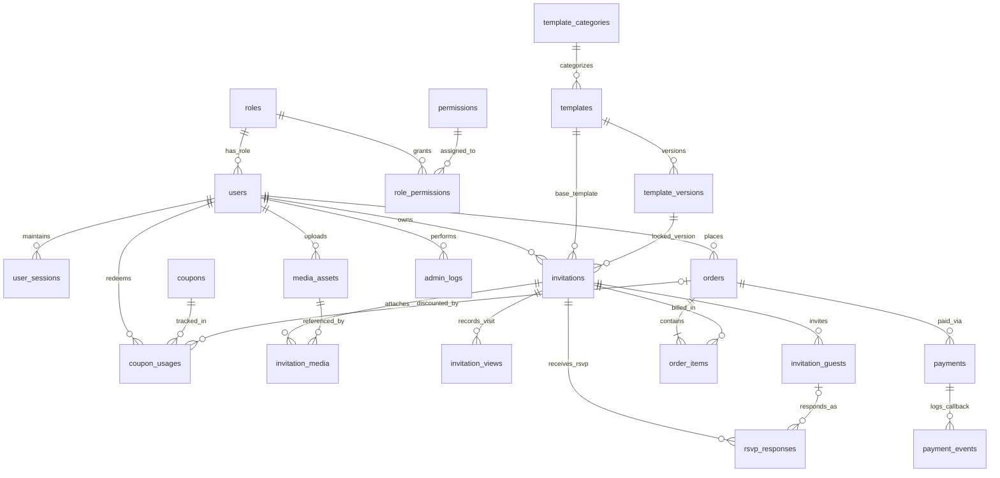

# طراحی دیتابیس و مدل رابطهای (DATABASE.md)

این سند مدل کامل دیتابیس رابطهای **PostgreSQL 16** برای پلتفرم دعوتنامه دیجیتال «ایوان» را شامل ۲۱ جدول نرمالسازیشده، نمودار ERD، کلیدهای خارجی (Foreign Keys)، ایندکسها، سیاستهای حذف اطلاعات و قوانین تراکنشهای مالی شرح میدهد.

---

## ۱. نمودار روابط موجودیتها (ERD — Mermaid & Relational Overview)

---

## ۲. اصول کلیدی معماری داده

1. **جداسازی شناسه داخلی و شناسه عمومی:** تمام جداول دارای کلید اصلی `id` از نوع `UUID (v4)` هستند. در هیچ API عمومی از شناسه ترتیبی (`1, 2, 3`) استفاده نمیشود تا حمله شمارش منابع (Enumeration / IDOR) غیرممکن گردد.
2. **مالکیت صریح منابع (Strict Ownership):** جداول `invitations`، `orders` و `media_assets` دارای فیلد اجباری `user_id` با کلید خارجی به `users(id)` هستند.
3. **تراکنشهای مالی ACID:** ایجاد سفارش، ثبت مصرف کوپن، تایید پرداخت و تغییر وضعیت دعوتنامه از `DRAFT` به `ACTIVE` منحصراً درون یک تراکنش دیتابیس (`SERIALIZABLE` / `READ COMMITTED` با `SELECT ... FOR UPDATE`) اجرا میشوند.
4. **واحد پولی استاندارد:** کلیه فیلدهای مبلغ (`price_toman`, `subtotal_toman`, `discount_toman`, `final_amount_toman`) از نوع `INTEGER` (تومان، غیرمنفی `CHECK (amount >= 0)`) هستند.

---

## ۳. مشخصات کامل ۲۱ جدول دیتابیس

### گروه A: کاربران، نقشها، مجوزها و نشستها

#### ۱. جدول `roles` (نقشهای کاربری)
| ستون | نوع داده | قیدها (Constraints) | توضیح |
| :--- | :--- | :--- | :--- |
| `id` | `UUID` | `PRIMARY KEY` | شناسه یکتای نقش |
| `code` | `VARCHAR(50)` | `UNIQUE NOT NULL` | کد نقش (`USER`, `ADMIN`, `SUPER_ADMIN`, `SUPPORT`) |
| `title_fa` | `VARCHAR(100)` | `NOT NULL` | عنوان فارسی نقش |
| `description` | `TEXT` | `NULL` | توضیحات سطح دسترسی |
| `created_at` | `TIMESTAMPTZ` | `NOT NULL DEFAULT NOW()` | زمان ایجاد |

#### ۲. جدول `permissions` (مجوزهای ریزدانه سیستم)
| ستون | نوع داده | قیدها | توضیح |
| :--- | :--- | :--- | :--- |
| `id` | `UUID` | `PRIMARY KEY` | شناسه مجوز |
| `code` | `VARCHAR(100)` | `UNIQUE NOT NULL` | کد مجوز (مانند `templates:write`, `orders:read_all`, `pricing:manage`) |
| `module` | `VARCHAR(50)` | `NOT NULL` | نام ماژول مرتبط |
| `title_fa` | `VARCHAR(150)` | `NOT NULL` | عنوان فارسی مجوز |
| `role_codes` | `TEXT[]` | `NOT NULL` | نگاشت نقشهای دارای این مجوز |

#### ۳. جدول `users` (کاربران سامانه)
| ستون | نوع داده | قیدها | توضیح |
| :--- | :--- | :--- | :--- |
| `id` | `UUID` | `PRIMARY KEY` | شناسه یکتای کاربر |
| `role_id` | `UUID` | `NOT NULL REFERENCES roles(id) ON DELETE RESTRICT` | نقش کاربر |
| `full_name` | `VARCHAR(120)` | `NOT NULL` | نام و نام خانوادگی |
| `phone_number` | `VARCHAR(15)` | `UNIQUE NOT NULL` | شماره موبایل ایران (`09xxxxxxxxx`) |
| `email` | `VARCHAR(255)` | `UNIQUE NULL` | آدرس ایمیل (اختیاری) |
| `password_hash` | `VARCHAR(255)` | `NOT NULL` | هش رمز عبور (`bcrypt` / `argon2id`) |
| `status` | `VARCHAR(20)` | `NOT NULL DEFAULT 'ACTIVE'` | وضعیت (`ACTIVE`, `SUSPENDED`, `PENDING_VERIFICATION`) |
| `failed_login_attempts` | `SMALLINT` | `NOT NULL DEFAULT 0` | شمارنده تلاش ناموفق ورود |
| `locked_until` | `TIMESTAMPTZ` | `NULL` | قفل موقت حساب در صورت Brute Force |
| `last_login_at` | `TIMESTAMPTZ` | `NULL` | آخرین زمان ورود |
| `created_at` | `TIMESTAMPTZ` | `NOT NULL DEFAULT NOW()` | زمان ثبتنام |
| `updated_at` | `TIMESTAMPTZ` | `NOT NULL DEFAULT NOW()` | زمان آخرین ویرایش |

- **ایندکسها:** `idx_users_phone (phone_number)`, `idx_users_email (email)`, `idx_users_role_status (role_id, status)`

#### ۴. جدول `user_sessions` (نشستهای فعال و Refresh Tokenها)
| ستون | نوع داده | قیدها | توضیح |
| :--- | :--- | :--- | :--- |
| `id` | `UUID` | `PRIMARY KEY` | شناسه نشست |
| `user_id` | `UUID` | `NOT NULL REFERENCES users(id) ON DELETE CASCADE` | مالک نشست |
| `refresh_token_hash` | `VARCHAR(255)` | `UNIQUE NOT NULL` | هش توکن نوسازی (هرگز بهصورت خام ذخیره نمیشود) |
| `ip_address` | `VARCHAR(45)` | `NOT NULL` | آدرس IP ایجادکننده نشست |
| `user_agent` | `VARCHAR(500)` | `NULL` | مشخصات مرورگر و دستگاه |
| `is_revoked` | `BOOLEAN` | `NOT NULL DEFAULT FALSE` | وضعیت ابطال نشست |
| `expires_at` | `TIMESTAMPTZ` | `NOT NULL` | زمان انقضای نشست |
| `created_at` | `TIMESTAMPTZ` | `NOT NULL DEFAULT NOW()` | زمان ایجاد |

- **ایندکسها:** `idx_sessions_user_active (user_id, is_revoked, expires_at)`

---

### گروه B: دستهبندیها، قالبها و نسخهبندی موتور قالب

#### ۵. جدول `template_categories` (دستهبندیهای قالب)
| ستون | نوع داده | قیدها | توضیح |
| :--- | :--- | :--- | :--- |
| `id` | `UUID` | `PRIMARY KEY` | شناسه دستهبندی |
| `slug` | `VARCHAR(60)` | `UNIQUE NOT NULL` | اسلاگ دسته (`wedding`, `birthday`, `engagement`, `party`, `opening`, `other`) |
| `name_fa` | `VARCHAR(100)` | `NOT NULL` | نام فارسی دسته (عروسی، تولد، نامزدی، مهمانی، افتتاحیه، مناسبتهای دیگر) |
| `description_fa` | `TEXT` | `NULL` | توضیحات دستهبندی |
| `sort_order` | `SMALLINT` | `NOT NULL DEFAULT 0` | ترتیب نمایش |
| `is_active` | `BOOLEAN` | `NOT NULL DEFAULT TRUE` | وضعیت فعال بودن |

#### ۶. جدول `templates` (کاتالوگ قالبهای دعوتنامه)
| ستون | نوع داده | قیدها | توضیح |
| :--- | :--- | :--- | :--- |
| `id` | `UUID` | `PRIMARY KEY` | شناسه قالب |
| `category_id` | `UUID` | `NOT NULL REFERENCES template_categories(id) ON DELETE RESTRICT` | دستهبندی قالب |
| `slug` | `VARCHAR(80)` | `UNIQUE NOT NULL` | شناسه متنی یکتا |
| `name_fa` | `VARCHAR(150)` | `NOT NULL` | نام فارسی قالب |
| `summary_fa` | `VARCHAR(300)` | `NOT NULL` | توضیح کوتاه قالب |
| `thumbnail_url` | `VARCHAR(500)` | `NOT NULL` | تصویر پیشنمایش کارت |
| `is_free` | `BOOLEAN` | `NOT NULL DEFAULT FALSE` | آیا قالب رایگان است؟ |
| `price_override_toman` | `INTEGER` | `NULL CHECK (price_override_toman >= 0)` | قیمت اختصاصی قالب (در صورت `NULL`، قیمت پایه سیستم لحاظ میشود) |
| `is_featured` | `BOOLEAN` | `NOT NULL DEFAULT FALSE` | نشان محبوب / ویژه |
| `is_new` | `BOOLEAN` | `NOT NULL DEFAULT TRUE` | نشان جدید |
| `status` | `VARCHAR(20)` | `NOT NULL DEFAULT 'PUBLISHED'` | وضعیت (`DRAFT`, `PUBLISHED`, `ARCHIVED`) |
| `current_version_id` | `UUID` | `NULL` | اشاره به آخرین نسخه منتشرشده در `template_versions` |
| `created_at` | `TIMESTAMPTZ` | `NOT NULL DEFAULT NOW()` | زمان ایجاد |
| `updated_at` | `TIMESTAMPTZ` | `NOT NULL DEFAULT NOW()` | زمان آخرین بروزرسانی |

- **ایندکسها:** `idx_templates_cat_status (category_id, status)`, `idx_templates_featured (is_featured, status)`

#### ۷. جدول `template_versions` (نسخهبندی تغییرناپذیر ساختار قالب)
| ستون | نوع داده | قیدها | توضیح |
| :--- | :--- | :--- | :--- |
| `id` | `UUID` | `PRIMARY KEY` | شناسه نسخه قالب |
| `template_id` | `UUID` | `NOT NULL REFERENCES templates(id) ON DELETE RESTRICT` | قالب والد |
| `version_number` | `INTEGER` | `NOT NULL CHECK (version_number >= 1)` | شماره نسخه (`1, 2, 3...`) |
| `engine_schema_json` | `JSONB` | `NOT NULL` | تعریف کامل Layout، Typography، Colors، Sections، Animations و Editable Fields |
| `default_content_json` | `JSONB` | `NOT NULL` | دادههای نمونه پیشفرض برای پیشنمایش زنده |
| `supports_music` | `BOOLEAN` | `NOT NULL DEFAULT TRUE` | آیا قالب از پخش موسیقی پشتیبانی میکند؟ |
| `supports_animations` | `BOOLEAN` | `NOT NULL DEFAULT TRUE` | آیا قالب از انیمیشن پشتیبانی میکند؟ |
| `changelog_note` | `VARCHAR(300)` | `NULL` | توضیح تغییرات این نسخه |
| `created_by` | `UUID` | `NULL REFERENCES users(id) ON DELETE SET NULL` | ادمین ایجادکننده نسخه |
| `created_at` | `TIMESTAMPTZ` | `NOT NULL DEFAULT NOW()` | زمان ثبت نسخه |

- **قید یکتا:** `UNIQUE (template_id, version_number)`

---

### گروه C: دعوتنامهها، رسانهها، بازدیدها و مهمانان (RSVP)

#### ۸. جدول `invitations` (دعوتنامههای کاربران)
| ستون | نوع داده | قیدها | توضیح |
| :--- | :--- | :--- | :--- |
| `id` | `UUID` | `PRIMARY KEY` | شناسه داخلی دعوتنامه |
| `user_id` | `UUID` | `NOT NULL REFERENCES users(id) ON DELETE RESTRICT` | کاربر مالک دعوتنامه |
| `template_id` | `UUID` | `NOT NULL REFERENCES templates(id) ON DELETE RESTRICT` | قالب انتخابشده |
| `template_version_id` | `UUID` | `NOT NULL REFERENCES template_versions(id) ON DELETE RESTRICT` | نسخه قفلشده قالب |
| `slug` | `VARCHAR(60)` | `UNIQUE NOT NULL` | اسلاگ اختصاصی مسیر عمومی (`/i/:slug` مانند `dayan123`) |
| `status` | `VARCHAR(25)` | `NOT NULL DEFAULT 'DRAFT'` | وضعیت (`DRAFT`, `PENDING_PAYMENT`, `ACTIVE`, `EXPIRED`, `SUSPENDED`) |
| `event_title` | `VARCHAR(200)` | `NOT NULL` | عنوان مراسم |
| `host_names` | `VARCHAR(200)` | `NOT NULL` | نام میزبانها (مثلاً نام عروس و داماد) |
| `event_date_utc` | `TIMESTAMPTZ` | `NOT NULL` | تاریخ و ساعت دقیق شروع مراسم |
| `event_jalali_label` | `VARCHAR(100)` | `NOT NULL` | نمایش متنی تاریخ شمسی (مثلاً `پنجشنبه ۲۴ آبان ۱۴۰۵`) |
| `event_time_label` | `VARCHAR(60)` | `NOT NULL` | بازه ساعت مراسم (مثلاً `ساعت ۱۹:۰۰ الی ۲۳:۰۰`) |
| `venue_name` | `VARCHAR(200)` | `NOT NULL` | نام تالار / باغ / محل برگزاری |
| `venue_address` | `TEXT` | `NOT NULL` | نشانی کامل پستی |
| `location_lat` | `NUMERIC(9,6)` | `NULL` | عرض جغرافیایی برای مسیریابی |
| `location_lng` | `NUMERIC(9,6)` | `NULL` | طول جغرافیایی برای مسیریابی |
| `invitation_text` | `TEXT` | `NOT NULL` | متن اصلی دعوتنامه |
| `contact_phone` | `VARCHAR(20)` | `NULL` | شماره تماس هماهنگی (در صورت تمایل میزبان) |
| `custom_fields_json` | `JSONB` | `NOT NULL DEFAULT '{}'` | مقادیر بخشهای اختصاصی قالب |
| `sections_config_json` | `JSONB` | `NOT NULL DEFAULT '{}'` | فعال/غیرفعال بودن بخشها (`gallery`, `map`, `rsvp`, `countdown`) |
| `music_enabled` | `BOOLEAN` | `NOT NULL DEFAULT TRUE` | وضعیت پخش موسیقی |
| `music_track_url` | `VARCHAR(500)` | `NULL` | آدرس فایل صوتی مجاز |
| `animation_enabled` | `BOOLEAN` | `NOT NULL DEFAULT TRUE` | وضعیت انیمیشنها |
| `rsvp_enabled` | `BOOLEAN` | `NOT NULL DEFAULT TRUE` | آیا فرم ثبت حضور مهمان فعال است؟ |
| `max_companions_per_guest`| `SMALLINT` | `NOT NULL DEFAULT 5 CHECK (max_companions_per_guest BETWEEN 0 AND 20)` | سقف تعداد همراه مجاز برای هر مهمان |
| `template_snapshot_json` | `JSONB` | `NOT NULL` | اسنپشات کامل ساختار قالب در لحظه انتشار جهت مصونیت از تغییرات بعدی قالب |
| `published_at` | `TIMESTAMPTZ` | `NULL` | زمان فعالسازی نهایی پس از پرداخت |
| `expires_at` | `TIMESTAMPTZ` | `NULL` | زمان انقضای نمایش عمومی |
| `created_at` | `TIMESTAMPTZ` | `NOT NULL DEFAULT NOW()` | زمان ایجاد |
| `updated_at` | `TIMESTAMPTZ` | `NOT NULL DEFAULT NOW()` | زمان آخرین ویرایش |

- **ایندکسها:** `idx_invitations_slug (slug)`, `idx_invitations_user_status (user_id, status)`, `idx_invitations_event_date (event_date_utc)`

#### ۹. جدول `media_assets` (فایلها و تصاویر آپلودشده)
| ستون | نوع داده | قیدها | توضیح |
| :--- | :--- | :--- | :--- |
| `id` | `UUID` | `PRIMARY KEY` | شناسه فایل رسانهای |
| `user_id` | `UUID` | `NOT NULL REFERENCES users(id) ON DELETE CASCADE` | کاربر آپلودکننده |
| `storage_key` | `VARCHAR(400)` | `UNIQUE NOT NULL` | کلید ذخیرهسازی در Object Storage |
| `public_url` | `VARCHAR(500)` | `NOT NULL` | آدرس عمومی CDN |
| `mime_type` | `VARCHAR(80)` | `NOT NULL` | نوع فایل تاییدشده (`image/webp`, `image/jpeg`, `image/png`, `audio/mpeg`) |
| `file_size_bytes` | `INTEGER` | `NOT NULL CHECK (file_size_bytes > 0 AND file_size_bytes <= 5242880)` | حجم فایل (حداکثر ۵ مگابایت) |
| `width_px` | `SMALLINT` | `NULL` | عرض تصویر |
| `height_px` | `SMALLINT` | `NULL` | ارتفاع تصویر |
| `sha256_checksum` | `CHAR(64)` | `NOT NULL` | هش محتوا جهت جلوگیری از تکرار و بررسی سلامت فایل |
| `created_at` | `TIMESTAMPTZ` | `NOT NULL DEFAULT NOW()` | زمان آپلود |

#### ۱۰. جدول `invitation_media` (اتصال فایلها به بخشهای دعوتنامه)
| ستون | نوع داده | قیدها | توضیح |
| :--- | :--- | :--- | :--- |
| `id` | `UUID` | `PRIMARY KEY` | شناسه اتصال |
| `invitation_id` | `UUID` | `NOT NULL REFERENCES invitations(id) ON DELETE CASCADE` | دعوتنامه مرتبط |
| `media_asset_id` | `UUID` | `NOT NULL REFERENCES media_assets(id) ON DELETE RESTRICT` | فایل رسانهای |
| `slot_key` | `VARCHAR(60)` | `NOT NULL` | جایگاه در قالب (`hero_cover`, `gallery_1`, `gallery_2`, `custom_audio`) |
| `sort_order` | `SMALLINT` | `NOT NULL DEFAULT 0` | ترتیب نمایش |

- **قید یکتا:** `UNIQUE (invitation_id, slot_key)`

#### ۱۱. جدول `invitation_views` (آمار بازدید صفحات عمومی دعوتنامه)
| ستون | نوع داده | قیدها | توضیح |
| :--- | :--- | :--- | :--- |
| `id` | `UUID` | `PRIMARY KEY` | شناسه رکورد بازدید |
| `invitation_id` | `UUID` | `NOT NULL REFERENCES invitations(id) ON DELETE CASCADE` | دعوتنامه بازدیدشده |
| `visitor_fingerprint_hash`| `CHAR(64)` | `NOT NULL` | هش ناشناس روزانه (`SHA256(IP + UserAgent + DateSalt)`) بدون ذخیره IP خام برای حفظ حریم خصوصی |
| `is_unique_daily` | `BOOLEAN` | `NOT NULL DEFAULT TRUE` | آیا اولین بازدید این مهمان در روز جاری است؟ |
| `device_type` | `VARCHAR(20)` | `NOT NULL` | نوع دستگاه (`MOBILE`, `DESKTOP`, `TABLET`) |
| `referrer_domain` | `VARCHAR(150)` | `NULL` | دامنه ارجاعدهنده |
| `viewed_at` | `TIMESTAMPTZ` | `NOT NULL DEFAULT NOW()` | زمان بازدید |

- **ایندکسها:** `idx_views_invitation_date (invitation_id, viewed_at)`, `idx_views_unique_lookup (invitation_id, visitor_fingerprint_hash)`

#### ۱۲. جدول `invitation_guests` (فهرست مهمانان اختصاصی دعوتشده توسط میزبان)
| ستون | نوع داده | قیدها | توضیح |
| :--- | :--- | :--- | :--- |
| `id` | `UUID` | `PRIMARY KEY` | شناسه مهمان |
| `invitation_id` | `UUID` | `NOT NULL REFERENCES invitations(id) ON DELETE CASCADE` | دعوتنامه مرتبط |
| `full_name` | `VARCHAR(120)` | `NOT NULL` | نام مهمان یا خانواده |
| `phone_number` | `VARCHAR(15)` | `NULL` | شماره موبایل مهمان (محرمانه، فقط قابل رویت توسط میزبان) |
| `invite_code` | `VARCHAR(30)` | `UNIQUE NULL` | کد اختصاصی مهمان (اختیاری برای لینکهای شخصی) |
| `allowed_companions` | `SMALLINT` | `NOT NULL DEFAULT 2` | سقف همراه مجاز برای این مهمان |
| `created_at` | `TIMESTAMPTZ` | `NOT NULL DEFAULT NOW()` | زمان ثبت توسط میزبان |

#### ۱۳. جدول `rsvp_responses` (پاسخهای حضور مهمانان)
| ستون | نوع داده | قیدها | توضیح |
| :--- | :--- | :--- | :--- |
| `id` | `UUID` | `PRIMARY KEY` | شناسه پاسخ |
| `invitation_id` | `UUID` | `NOT NULL REFERENCES invitations(id) ON DELETE CASCADE` | دعوتنامه مرتبط |
| `guest_id` | `UUID` | `NULL REFERENCES invitation_guests(id) ON DELETE SET NULL` | اتصال به مهمان ازپيشتعریفشده (در صورت وجود) |
| `respondent_name` | `VARCHAR(120)` | `NOT NULL` | نام و نام خانوادگی ثبتکننده پاسخ |
| `respondent_phone_hash` | `CHAR(64)` | `NULL` | هش شماره تماس یا توکن نشست جهت جلوگیری از ثبت تکراری |
| `attendance_status` | `VARCHAR(20)` | `NOT NULL` | وضعیت حضور (`ATTENDING`, `NOT_ATTENDING`, `MAYBE`) |
| `companions_count` | `SMALLINT` | `NOT NULL DEFAULT 0 CHECK (companions_count >= 0)` | تعداد همراهان |
| `guest_message` | `VARCHAR(500)` | `NULL` | پیام تبریک یا یادداشت مهمان برای میزبان |
| `submitted_ip_hash` | `CHAR(64)` | `NOT NULL` | هش IP برای جلوگیری از اسپم |
| `created_at` | `TIMESTAMPTZ` | `NOT NULL DEFAULT NOW()` | زمان ثبت پاسخ |
| `updated_at` | `TIMESTAMPTZ` | `NOT NULL DEFAULT NOW()` | زمان ویرایش پاسخ |

- **قید جلوگیری از ثبت تکراری:** `UNIQUE NULLS NOT DISTINCT (invitation_id, respondent_phone_hash)`
- **ایندکسها:** `idx_rsvp_invitation_status (invitation_id, attendance_status)`

---

### گروه D: سفارشها، پرداختها و کدهای تخفیف

#### ۱۴. جدول `coupons` (کدهای تخفیف و کمپینهای فروش)
| ستون | نوع داده | قیدها | توضیح |
| :--- | :--- | :--- | :--- |
| `id` | `UUID` | `PRIMARY KEY` | شناسه کوپن |
| `code` | `VARCHAR(40)` | `UNIQUE NOT NULL` | کد تخفیف (بزرگ و بدون فاصله، مثلاً `BAHAR1405`) |
| `discount_type` | `VARCHAR(15)` | `NOT NULL` | نوع تخفیف (`PERCENTAGE`, `FIXED_TOMAN`) |
| `discount_value` | `INTEGER` | `NOT NULL CHECK (discount_value > 0)` | مقدار تخفیف (درصد ۱ تا ۱۰۰ یا مبلغ به تومان) |
| `max_discount_toman` | `INTEGER` | `NULL` | سقف تخفیف برای کدهای درصدی |
| `min_order_toman` | `INTEGER` | `NOT NULL DEFAULT 0` | حداقل مبلغ سفارش برای اعمال کوپن |
| `usage_limit_total` | `INTEGER` | `NULL` | سقف کل دفعات استفاده در سیستم |
| `usage_limit_per_user` | `SMALLINT` | `NOT NULL DEFAULT 1` | سقف استفاده به ازای هر کاربر |
| `used_count` | `INTEGER` | `NOT NULL DEFAULT 0` | تعداد دفعات استفادهشده تا این لحظه |
| `starts_at` | `TIMESTAMPTZ` | `NOT NULL` | زمان شروع اعتبار |
| `expires_at` | `TIMESTAMPTZ` | `NOT NULL` | زمان پایان اعتبار |
| `is_active` | `BOOLEAN` | `NOT NULL DEFAULT TRUE` | وضعیت فعال بودن |
| `created_at` | `TIMESTAMPTZ` | `NOT NULL DEFAULT NOW()` | زمان ایجاد |

#### ۱۵. جدول `orders` (سفارشهای خرید و انتشار دعوتنامه)
| ستون | نوع داده | قیدها | توضیح |
| :--- | :--- | :--- | :--- |
| `id` | `UUID` | `PRIMARY KEY` | شناسه سفارش |
| `order_number` | `VARCHAR(30)` | `UNIQUE NOT NULL` | شماره سفارش قابلمشاهده کاربر (مثلاً `INV-1405-89412`) |
| `user_id` | `UUID` | `NOT NULL REFERENCES users(id) ON DELETE RESTRICT` | کاربر خریدار |
| `invitation_id` | `UUID` | `NOT NULL REFERENCES invitations(id) ON DELETE RESTRICT` | دعوتنامه موضوع سفارش |
| `coupon_id` | `UUID` | `NULL REFERENCES coupons(id) ON DELETE RESTRICT` | کد تخفیف اعمالشده |
| `status` | `VARCHAR(25)` | `NOT NULL DEFAULT 'PENDING'` | وضعیت (`PENDING`, `PAID`, `FAILED`, `CANCELED`, `REFUNDED`) |
| `subtotal_toman` | `INTEGER` | `NOT NULL CHECK (subtotal_toman >= 0)` | مبلغ پایه محاسبهشده در سرور (مثلاً ۵۰٬۰۰۰ تومان) |
| `discount_toman` | `INTEGER` | `NOT NULL DEFAULT 0 CHECK (discount_toman >= 0)` | مبلغ تخفیف محاسبهشده در سرور |
| `final_amount_toman` | `INTEGER` | `NOT NULL CHECK (final_amount_toman >= 0)` | مبلغ قابل پرداخت نهایی (`subtotal - discount`) |
| `idempotency_key` | `VARCHAR(80)` | `UNIQUE NOT NULL` | کلید یکتا برای جلوگیری از ثبت سفارش تکراری با دوبار کلیک |
| `paid_at` | `TIMESTAMPTZ` | `NULL` | زمان قطعی شدن پرداخت |
| `created_at` | `TIMESTAMPTZ` | `NOT NULL DEFAULT NOW()` | زمان ثبت سفارش |
| `updated_at` | `TIMESTAMPTZ` | `NOT NULL DEFAULT NOW()` | زمان آخرین تغییر |

- **ایندکسها:** `idx_orders_user_status (user_id, status)`, `idx_orders_invitation (invitation_id, status)`

#### ۱۶. جدول `order_items` (اقلام سفارش)
| ستون | نوع داده | قیدها | توضیح |
| :--- | :--- | :--- | :--- |
| `id` | `UUID` | `PRIMARY KEY` | شناسه ردیف سفارش |
| `order_id` | `UUID` | `NOT NULL REFERENCES orders(id) ON DELETE CASCADE` | سفارش والد |
| `invitation_id` | `UUID` | `NOT NULL REFERENCES invitations(id) ON DELETE RESTRICT` | دعوتنامه مرتبط |
| `item_type` | `VARCHAR(30)` | `NOT NULL DEFAULT 'INVITATION_PUBLISH'` | نوع آیتم (`INVITATION_PUBLISH`, `PREMIUM_TEMPLATE`, `EXTENSION`) |
| `title_fa` | `VARCHAR(200)` | `NOT NULL` | شرح ردیف در فاکتور |
| `unit_price_toman` | `INTEGER` | `NOT NULL CHECK (unit_price_toman >= 0)` | قیمت واحد در لحظه ثبت |
| `quantity` | `SMALLINT` | `NOT NULL DEFAULT 1 CHECK (quantity = 1)` | تعداد |
| `line_total_toman` | `INTEGER` | `NOT NULL CHECK (line_total_toman >= 0)` | جمع ردیف |

#### ۱۷. جدول `coupon_usages` (سوابق مصرف کدهای تخفیف)
| ستون | نوع داده | قیدها | توضیح |
| :--- | :--- | :--- | :--- |
| `id` | `UUID` | `PRIMARY KEY` | شناسه مصرف کوپن |
| `coupon_id` | `UUID` | `NOT NULL REFERENCES coupons(id) ON DELETE RESTRICT` | کوپن مرتبط |
| `user_id` | `UUID` | `NOT NULL REFERENCES users(id) ON DELETE RESTRICT` | کاربر استفادهکننده |
| `order_id` | `UUID` | `UNIQUE NOT NULL REFERENCES orders(id) ON DELETE CASCADE` | سفارش مرتبط |
| `discount_applied_toman`| `INTEGER` | `NOT NULL` | مبلغ تخفیف اعمالشده |
| `used_at` | `TIMESTAMPTZ` | `NOT NULL DEFAULT NOW()` | زمان ثبت قطعی |

#### ۱۸. جدول `payments` (تراکنشهای پرداخت بانکی)
| ستون | نوع داده | قیدها | توضیح |
| :--- | :--- | :--- | :--- |
| `id` | `UUID` | `PRIMARY KEY` | شناسه تراکنش |
| `order_id` | `UUID` | `NOT NULL REFERENCES orders(id) ON DELETE RESTRICT` | سفارش مرتبط |
| `user_id` | `UUID` | `NOT NULL REFERENCES users(id) ON DELETE RESTRICT` | کاربر پرداختکننده |
| `gateway_provider` | `VARCHAR(30)` | `NOT NULL` | نام درگاه (`ZARINPAL`, `ZIBAL`, `MOCK_SANDBOX`) |
| `authority_token` | `VARCHAR(120)` | `UNIQUE NOT NULL` | شناسه یکتای ارجاع به درگاه (`Authority` / `TrackId`) |
| `amount_toman` | `INTEGER` | `NOT NULL CHECK (amount_toman > 0)` | مبلغ به تومان |
| `amount_rial` | `BIGINT` | `NOT NULL CHECK (amount_rial = amount_toman * 10)` | مبلغ ارسالی به درگاه بانکی به ریال |
| `status` | `VARCHAR(25)` | `NOT NULL DEFAULT 'INITIATED'` | وضعیت (`INITIATED`, `VERIFIED`, `FAILED`, `DUPLICATE_IGNORED`) |
| `reference_id` | `VARCHAR(100)` | `NULL` | کد رهگیری نهایی بانک (`RefID`) پس از Verify موفق |
| `masked_card_pan` | `VARCHAR(20)` | `NULL` | شماره کارت ماسکشده (`6037-****-****-1234`) |
| `verified_at` | `TIMESTAMPTZ` | `NULL` | زمان تایید سمت سرور |
| `created_at` | `TIMESTAMPTZ` | `NOT NULL DEFAULT NOW()` | زمان شروع تراکنش |

- **ایندکسها:** `idx_payments_order (order_id)`, `idx_payments_authority (authority_token)`, `idx_payments_ref (reference_id)`

#### ۱۹. جدول `payment_events` (لاگ تغییرناپذیر رویدادها و Callbackهای درگاه)
| ستون | نوع داده | قیدها | توضیح |
| :--- | :--- | :--- | :--- |
| `id` | `UUID` | `PRIMARY KEY` | شناسه رویداد |
| `payment_id` | `UUID` | `NOT NULL REFERENCES payments(id) ON DELETE RESTRICT` | تراکنش مرتبط |
| `event_type` | `VARCHAR(40)` | `NOT NULL` | نوع رویداد (`TOKEN_REQUESTED`, `CALLBACK_RECEIVED`, `VERIFY_SUCCESS`, `VERIFY_FAILED`, `REPLAY_BLOCKED`) |
| `raw_payload_json` | `JSONB` | `NOT NULL` | داده دریافتی/ارسالی بدون اطلاعات حساس |
| `source_ip` | `VARCHAR(45)` | `NULL` | IP ارسالکننده Callback |
| `created_at` | `TIMESTAMPTZ` | `NOT NULL DEFAULT NOW()` | زمان ثبت رویداد |

---

### گروه E: مدیریت سیستم و لاگهای ممیزی (Audit Logs)

#### ۲۰. جدول `admin_logs` (ثبت ممیزی عملیات حساس مدیران)
| ستون | نوع داده | قیدها | توضیح |
| :--- | :--- | :--- | :--- |
| `id` | `UUID` | `PRIMARY KEY` | شناسه لاگ ممیزی |
| `actor_user_id` | `UUID` | `NOT NULL REFERENCES users(id) ON DELETE RESTRICT` | مدیر انجامدهنده عملیات |
| `action` | `VARCHAR(80)` | `NOT NULL` | نوع اقدام (مثلاً `PRICE_BASE_UPDATED`, `TEMPLATE_VERSION_PUBLISHED`, `USER_SUSPENDED`) |
| `target_entity` | `VARCHAR(50)` | `NOT NULL` | جدول/منبع هدف |
| `target_id` | `VARCHAR(80)` | `NOT NULL` | شناسه رکورد هدف |
| `before_state_json` | `JSONB` | `NULL` | وضعیت قبل از تغییر |
| `after_state_json` | `JSONB` | `NULL` | وضعیت بعد از تغییر |
| `ip_address` | `VARCHAR(45)` | `NOT NULL` | آدرس IP مدیر |
| `created_at` | `TIMESTAMPTZ` | `NOT NULL DEFAULT NOW()` | زمان دقیق ثبت |

#### ۲۱. جدول `system_settings` (تنظیمات کلان و قیمت پایه از پنل مدیریت)
| ستون | نوع داده | قیدها | توضیح |
| :--- | :--- | :--- | :--- |
| `key` | `VARCHAR(80)` | `PRIMARY KEY` | کلید تنظیم (مانند `base_invitation_price_toman`, `active_payment_gateway`, `maintenance_mode`) |
| `value_json` | `JSONB` | `NOT NULL` | مقدار تنظیم (مثلاً `{"amountToman": 50000}`) |
| `description_fa` | `VARCHAR(250)` | `NOT NULL` | توضیح فارسی تنظیم در پنل ادمین |
| `updated_by` | `UUID` | `NULL REFERENCES users(id) ON DELETE SET NULL` | آخرین مدیر ویرایشکننده |
| `updated_at` | `TIMESTAMPTZ` | `NOT NULL DEFAULT NOW()` | زمان آخرین تغییر |

---

## ۴. سیاست حذف اطلاعات (Deletion & Retention Policy)

1. **ممنوعیت حذف فیزیکی رکوردهای مالی (`ON DELETE RESTRICT`):** جداول `orders`، `order_items`، `payments`، `payment_events` و `admin_logs` تحت هیچ شرایطی نباید `DELETE` شوند.
2. **حذف دعوتنامه توسط کاربر:** دعوتنامههایی که پرداخت شدهاند در صورت درخواست کاربر به وضعیت `SUSPENDED` / `ARCHIVED` تغییر میکنند تا لینک عمومی `/i/:slug` غیرفعال شود، اما سابقه تراکنش مالی حفظ میگردد.
3. **پاکسازی نشستهای منقضی:** رکوردهای منقضیشده جدول `user_sessions` پس از ۳۰ روز توسط کارگر پسزمینه (Worker) پاکسازی میشوند.
